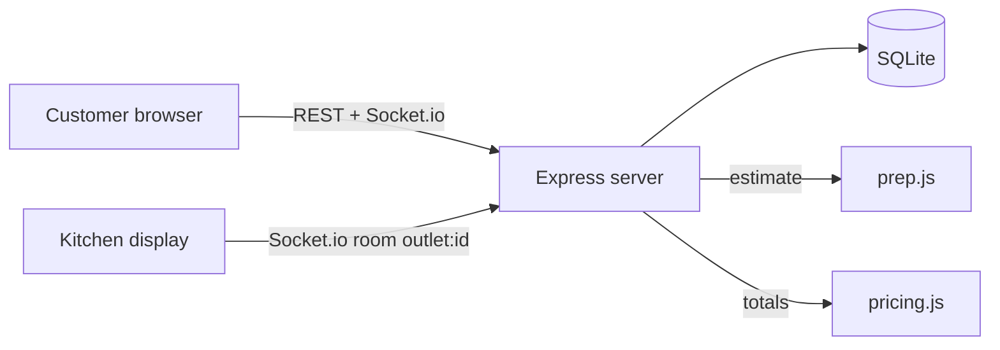

# Dum House — direct ordering + kitchen display

A Hyderabad biryani chain's own ordering site, built for the Isocode SDE
submission (problem #1). Customers order direct instead of through delivery
apps; orders land instantly on the right outlet's kitchen screen; the
promised time is computed honestly from kitchen load, never invented.

**Live URL:** _placeholder — fill in after deploying from your own account
(see `deployment.md`). No live deployment was created by the builder._

## The 60-second demo

See [`DEMO.md`](DEMO.md). In short: sign in as customer → Kondapur →
add Chicken Dum Biryani (Family) → test UPI checkout → open the Kitchen
tab in a second tab → the order appears instantly with a ticking timer
and its prep breakdown.

## Demo logins (password for all: `Demo123!`)

| Role | Email | Notes |
|---|---|---|
| Customer | `customer@demo.in` | 240 loyalty points, past orders for reorder suggestions |
| Kitchen | `kitchen@demo.in` | Kondapur outlet only |
| Manager | `manager@demo.in` | Menu CMS, dashboard, promise overrides, all outlets' KDS |

## Architecture (in words)

```
Browser (Vite + React, one page app)
   │  REST + Socket.io (same origin in production)
   ▼
Express server (server/src/server.js)
   ├── SQLite via node:sqlite (no native modules, file at DATA_DIR/app.db)
   ├── JWT auth + bcrypt passwords + role middleware
   ├── Socket.io rooms: outlet:<id> (KDS + menu updates), order:<no> (tracking)
   └── Pure logic modules: prep.js (estimator), pricing.js (totals), kds.js (KDS sort)
```



Why this stack: one deployable unit, zero native build steps, no database
server to provision — a reviewer can run it in minutes. It is deliberately
*not* the architecture for the brief's 1,200 orders/hour peak (see Limits).

## Data model (summary)

- `users` — id, name, email (unique), password_hash, role
  (`customer`/`kitchen`/`manager`), outlet_id (kitchen staff), points.
- `outlets` — name, address, phone, FSSAI licence, min_prep_minutes,
  delivery_radius_km.
- `items` — name, category, description, price (GST-inclusive), veg,
  spice, allergens, photo, portions/add-ons (JSON), base_minutes, menu_tag.
- `item_outlets` — per-outlet availability + out_of_stock flag.
- `coupons` — code, percent/flat, min_order.
- `orders` — order_no, user, outlet, status, subtotal/coupon/loyalty/
  payable, GST amount, payment method/ref, estimate + breakdown,
  promised_at, promise_override, request_key (idempotency),
  delivery_address (stored at checkout, shown on tracking + KDS).
- `order_items`, `order_events` (audit: who/when/from→to), `party_enquiries`.

## How the "AI" prep estimator works — and where it can be wrong

There is **no LLM call** in this demo, by design. `server/src/prep.js` is a
deterministic, explainable estimator:

```
base      = slowest item's base minutes + 3 min per extra distinct line
queueLoad = min(active New/Preparing orders × 4, 30)
promised  = max(base + queueLoad, outlet minimum)
```

The checkout and the KDS both show the breakdown, so a reviewer can check
the arithmetic. Failure handling, as the brief requires:

- It can be wrong when the kitchen is slower than its base times, when a
  large party order lands, or when staff are short — so the promise is
  floored at the outlet minimum, a manager can override it (stored +
  audited in the order history), 10+ minutes past promise raises a manager
  alert banner on the KDS and a "Running late — we're on it" note for the
  customer, and nothing is ever auto-added to a cart from a suggestion.
- Reorder suggestions are past-order items with an explicit Add button only.

## Security notes

- Server recomputes every total from DB prices, coupons and loyalty; a
  client-sent total is not even accepted as an input (tested).
- Quantities (1–20), outlet, items, portions and add-ons are validated
  server-side; unknown/out-of-stock items are rejected with 400.
- Role checks on every mutation: kitchen staff can only see/update their
  own outlet; customers only their own orders; admin routes require manager.
- JWT (12h) + bcrypt hashes. No secrets in the repo: `.env.example` lists
  names only; production refuses to start without `JWT_SECRET`.
- Double-submit guard: checkout sends a client-generated request key; a
  retry with the same key returns the original order instead of duplicating
  it (and a failed test payment creates no order, so retry keeps the cart).

## What was deliberately cut — and why

- **Per-city/per-outlet pricing:** the brief's CMS asks for prices by city.
  This demo uses one price per item. Faking a per-city UI that does nothing
  would be worse than an honest single price; the TDD outline lists this
  as the first next step (a real `item_prices` table).
- **Delivery-app integration, rider app, billing/inventory replacement:**
  explicitly out of scope in the brief. Riders, WhatsApp/SMS and real
  payment gateways are mocked or labelled TEST MODE.
- **Real-time at peak scale:** SQLite + a single Node instance + in-process
  Socket.io is right for a demo, not for 1,200 orders/hour. Next step:
  Postgres + Redis pub/sub + horizontal instances (see TDD outline).
- **LLM features:** no fake AI text. The estimator above is the honest
  version of "AI prep-time" for a demo with no model key.

## Must Have → screen map (full list)

| Must Have | Where it works |
|---|---|
| Outlet by location + radius | Menu page: area picker → nearest in-radius outlet auto-selected; outside-radius state; optional geolocation |
| Menu, GST, FSSAI | Menu cards (photos, portions, add-ons, veg symbols, spice, allergens, time windows) + checkout GST breakdown |
| Cart, coupons, loyalty, test payment, marketing opt-in, delivery address | Cart drawer (DIRECT10, WELCOME100, 100 pts = ₹50); opt-in unchecked by default, stored, toggleable in My orders; delivery address pre-filled with the delivery area, stored on the order, shown on tracking + KDS |
| Menu CMS: price by city, availability, time menus, portion/add-on authoring | Admin → Menu CMS: Hyderabad base price + per-outlet override (really changes that outlet's price); Lunch/Dinner/All day enforced; portions and add-ons are authored in the form and orderable immediately; unchecking an outlet removes the item from that outlet's menu |
| Kitchen display | Kitchen view: live socket, 5 stages incl. Rider handoff, late red + 10+ min alert, override, live stock pause |
| Loyalty history | My orders → Loyalty points: balance + earned/redeemed per order |
| Party + confirmation | Party orders tab + Admin → Party enquiries (Confirm/Decline + note) + customer status in My orders |
| Dashboard by outlet | Admin → Dashboard: orders, revenue, median prep, late, cancellations, repeat customers per outlet |
| Prep estimator, reorder, notifications | Checkout/KDS breakdown; "Order again" (explicit Add only); mock notification log on tracking |
| Roles | Customer / kitchen (own outlet only) / manager — **manager explicitly covers both outlet manager and central marketing/admin**; no fourth half-working role |

Out of scope (not built, per the brief): delivery-app integration, an own
rider app, replacing outlet billing/inventory. Constraints shown in the
UI: DPDP opt-in note, "Prices include 5% GST", KDS readability for cheap
tablets, and the honest scale limit below.

## Run it

```bash
npm run install:all
npm test          # in server/ — 25 tests, must pass
npm run build     # builds the client
npm start         # serves API + built frontend on http://localhost:4000
```

Full steps, Render deploy and env var names: [`deployment.md`](deployment.md).
